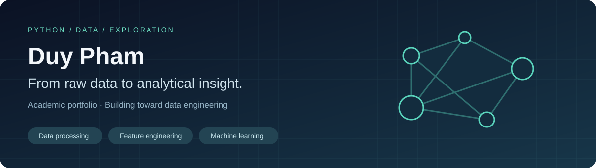
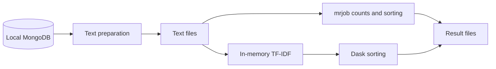
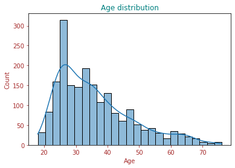
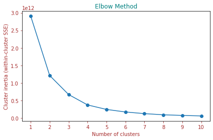

# Duy Pham — Data Projects

A selection of academic projects covering Python data processing, data preparation and machine learning. This portfolio highlights the foundations I am building on as I move toward Data Engineer roles.

## Start here

| Project | What the code demonstrates | Main tools |
| --- | --- | --- |
| [Text processing with MapReduce & Dask](MapReduce%20%26%20DASK/) | MongoDB-to-file preparation, map/reduce aggregation, sorting and TF-IDF processing | Python, MongoDB, mrjob, Dask, pandas, scikit-learn, NLTK |
| [Melbourne Airbnb price prediction](Predicting%20house%20rental%20price%20in%20Melbourne/) | Data cleaning and feature engineering within a team forecasting assignment; my assigned contribution was Task 2 | Python, pandas, scikit-learn |
| [Customer clustering](Customer%20clustering%20project/) | CSV exploration, customer segmentation and cluster summaries | Python, pandas, scikit-learn |

## A look inside the projects

### Text processing workflow

The MapReduce project prepares MongoDB records for separate counting, sorting and ranking scripts. This diagram summarizes the local workflow; the TF-IDF model is fitted in memory before conversion to Dask.

### Customer clustering notebook

<table>
  <tr>
    <th>Explore the customer data</th>
    <th>Inspect cluster inertia</th>
  </tr>
  <tr>
    <td></td>
    <td></td>
  </tr>
</table>

These figures are copied from the notebook's saved outputs. They illustrate the original exploration, not a fresh execution or validated model performance. [Explore the clustering project](Customer%20clustering%20project/).

## Other work

- [Prostate Cancer Classification](Prostate%20Cancer%20Classification/): an academic classification notebook using scikit-learn Pipelines and XGBoost. The referenced input dataset is not included.
- [Excel Coffee Sales Analysis](Excel%20Coffee%20Sales%20Analysis/): an Excel workbook.

## How to explore

Start with the project READMEs, then inspect the linked scripts or notebooks. Original coursework and reports are retained for context. Recorded notebook outputs are historical artifacts, not evidence of a recent successful run.

These projects demonstrate local processing and analytical workflows. They are not production deployments. Setup requirements and known reproducibility gaps are documented per project; there is not yet a validated repository-wide environment or automated test suite.

## Engineering refresh priorities

- [ ] Reproduce the MapReduce word and city counts with a small synthetic fixture and exact expected outputs.
- [ ] Record tested Python/package versions and required NLP resources.
- [ ] Resolve missing notebook inputs using their original authorized sources.
- [ ] Add focused data-quality tests and a CI workflow after establishing a clean local run.
- [ ] Add useful execution timing, row counts and failure reporting.

SQL, Spark, Airflow and AWS are potential future extensions, not implemented capabilities claimed by this repository.
